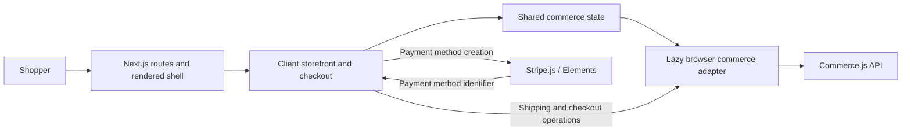

# Joy's Store

A Next.js storefront with product browsing, a shopping cart, and a two-step checkout integrated with Commerce.js and Stripe.

The portfolio direction is a polished, single-store commerce demo that shows the complete journey from a shopper placing an order to a merchant managing it. The goal is to demonstrate senior full-stack engineering through clear product decisions, reliable transactions, maintainable boundaries, and evidence from tests.

**Current status:** the Next.js foundation and shopper-facing checkout are implemented. Commerce.js supplies the external commerce backend. An application API, database, merchant tools, and a credential-free purchasing demo remain planned.

## What works today

- Next.js App Router routes for the catalog (`/`), cart (`/cart`), and checkout (`/checkout`), including direct navigation and reloads.
- Responsive product cards and cart quantity, removal, and clearing actions.
- Shipping country, region, and delivery-method selection, including countries without regions.
- Order review and payment amount based on Commerce.js shipping and tax calculations.
- Confirmation only after a successful capture returns an order; references come from the provider.
- Visible service errors and retries, address restoration when going back, and protection against repeated in-flight payment submissions.
- Checkout regression tests and production-browser smoke tests, with automated lint, test, and build checks.

## Foundation and architecture

| Area | Choice |
| --- | --- |
| Framework | Next.js 16.4.3 App Router with React 19.3.1 |
| Runtime | Node.js 24.22.2, pinned in `.nvmrc` |
| Package manager | npm 11.19.1, one committed `package-lock.json`, exact dependency versions |
| UI | Material UI 9.5.0 with Emotion and the Next.js App Router cache provider |
| Forms and payments | React Hook Form 7 and Stripe Elements |
| Verification | ESLint, Jest/React Testing Library, and Playwright |



`src/app` owns routing, metadata, the shared layout, and UI providers. `src/context/CommerceContext.jsx` preserves catalog and cart state across route navigation. Components under `src/components/CheckoutForm` collect the address, request totals, submit payment, and display the returned order.

`src/lib/commerce.js` loads the Commerce.js 2.8 SDK lazily in the browser. Importing or building a route does not initialize the SDK or require merchant credentials. The application shell is rendered by Next.js; product data, cart state, and checkout remain client-side during this migration. There are no application API endpoints or database yet.

The SDK’s Axios dependency is pinned to the patched 0.34.0 release through a scoped override. Contract tests cover the request and response shapes used by this app.

The browser passes a Stripe payment-method identifier to Commerce.js for order capture. [The architecture decision](docs/decisions/0001-next-foundation.md) explains the framework choice and migration boundaries.

## Run locally

Use Node.js **24.22.2** and npm **11.19.1**. If you use nvm, `nvm install` and `nvm use` read the pinned version from `.nvmrc`.

```sh
npm ci
cp .env.example .env.local
```

Fill the ignored `.env.local` file with your own public configuration:

```dotenv
NEXT_PUBLIC_COMMERCE_PUBLIC_KEY=your_commerce_public_key
NEXT_PUBLIC_STRIPE_PUBLISHABLE_KEY=your_stripe_publishable_key
```

Configure products, shipping options, and the Stripe gateway in the connected Commerce.js store, then start development:

```sh
npm run dev
```

Open [localhost:3000](http://localhost:3000). Without merchant keys, the app starts and shows a recoverable unavailable state; it does not populate a demo catalog or simulate purchases yet.

Next.js exposes `NEXT_PUBLIC_*` values to the browser and includes them in the build. Use only public or publishable keys, and rebuild after changing them for production. The old `REACT_APP_*` names are no longer used. Do not commit `.env.local` or place secret keys in browser configuration.

To run a production build locally:

```sh
npm run build
npm start
```

## Verify changes

| Command | Purpose |
| --- | --- |
| `npm run lint` | Check the codebase with no allowed lint warnings |
| `npm test` | Run Jest; append `-- --watch` for watch mode |
| `npm run test:ci` | Run the regression suite serially in CI mode |
| `npm run build` | Create the production Next.js build |
| `npm run check` | Run lint, regression tests, and the production build |
| `npm run test:e2e` | Build and start the app on port 3100, then run browser smoke tests |

Install Playwright's browser before the first browser-test run:

```sh
npx playwright install chromium
npm run test:e2e
```

Alternatively, use an already installed Google Chrome:

```sh
PLAYWRIGHT_CHANNEL=chrome npm run test:e2e
```

The Jest suite covers confirmed and failed captures, slow responses, duplicate submissions, cart preservation, shipping/tax calculations, lookup failures, stale responses, and address restoration. Component tests mock provider interactions. SDK contract tests use the real Commerce.js and Axios packages with an injected in-memory HTTP adapter. No test charges a card or proves live provider integration correctness.

Playwright checks the production app without merchant keys: direct route entry and reload, navigation, a usable not-found page, and graceful unavailable states without provider requests or hydration errors. This is a foundation smoke suite, not a successful-purchase browser test.

[GitHub Actions](.github/workflows/ci.yml) runs lint, Jest, and the production Playwright checks on pushes and pull requests. Browser traces and screenshots are saved locally on failure. No merchant credentials are required by CI.

## Portfolio roadmap

Each milestone should leave a working, demonstrable application. Scope is one store and one merchant workflow.

| Milestone | Status and concrete result | Engineering discussion it supports |
| --- | --- | --- |
| 1a. Project foundation | Implemented: maintained runtime, Next.js routes, npm lockfile, modern UI dependencies, and automated checks | Reproducibility, framework boundaries, migration safety |
| 1b. Reproducible purchasing demo | Next: seeded products, explicit simulation mode, simulated purchases, and controlled failure recovery | Provider interfaces, deterministic testing, integration design |
| 2. Complete shopper experience | Planned: branding, product details, discovery, mobile polish, keyboard access, and measured performance | Product judgment, accessibility, frontend architecture |
| 3. Full-stack order workflow | Planned: application API and database, authoritative price/availability checks, persisted orders, and authenticated merchant order management | Data modeling, authorization, concurrency, transaction boundaries |
| 4. Reliable operation | Planned: duplicate-safe processing, provider reconciliation, deeper browser/API tests, structured diagnostics, and recovery instructions | Failure handling, observability, security, operating a service |
| 5. Interview presentation | Planned: hosted demo, screenshots, decision records, measured results, and a walkthrough of success and failure paths | Explaining tradeoffs and supporting claims with evidence |

### Next milestone: anyone can evaluate a complete purchase

Acceptance criteria:

1. A developer can start a seeded demo using documented commands without merchant credentials.
2. A reviewer can browse products, change the cart, select shipping, and complete a clearly simulated purchase.
3. A controlled service failure produces a useful message and a working recovery path.
4. Live and demo commerce implementations share an explicit interface.
5. Browser tests exercise the simulated purchase as well as the existing foundation checks.

## Current limits

- Next.js provides the framework for future server routes; the current commerce integration still runs through the external provider from the browser.
- Shipping and tax amounts come from Commerce.js, rather than arithmetic on formatted prices in the UI.
- In-flight button protection applies to the current UI session. Server-side idempotency and recovery after ambiguous payment outcomes remain future work.
- A functioning merchant account is still needed for real catalog and checkout behavior. Provider sandbox checks, application order persistence, and operational monitoring remain future work.
- Planned features and metrics should be presented as completed only after implementation and verification.
