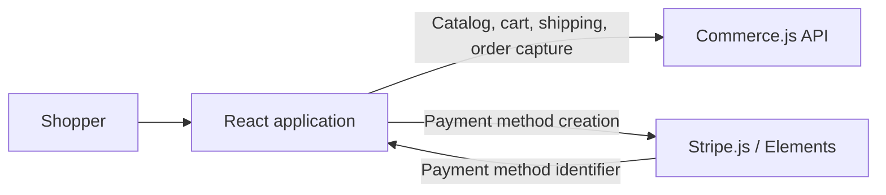

# Joy's Store

A React storefront with product browsing, a shopping cart, and a two-step checkout integrated with Commerce.js and Stripe.

The portfolio direction is a polished, single-store commerce demo that shows the complete journey from a shopper placing an order to a merchant managing it. The goal is to demonstrate senior full-stack engineering through clear product decisions, reliable transactions, maintainable boundaries, and evidence from tests.

**Current status:** the shopper-facing application is implemented. Commerce.js supplies the external commerce backend. A backend owned by this repository, persistent application orders, merchant tools, and a credential-free demo mode are planned.

## What works today

- Responsive product catalog and cart quantity, removal, and clearing actions.
- Shipping country, region, and delivery-method selection, including countries without regions.
- Order review and payment amount based on Commerce.js shipping and tax calculations.
- Confirmation only after a successful capture returns an order; references come from the provider.
- Visible checkout errors, retryable shipping lookups, and preserved address details when going back.
- Protection against repeated payment submissions while a request is in progress.
- Forty automated regression tests across five suites, including the complete address-to-confirmation UI flow.

## Current architecture



`src/App.js` coordinates catalog and cart requests. Components under `src/components/CheckoutForm` manage address collection, server-calculated totals, payment submission, and confirmation. `src/lib/commerce.js` initializes the commerce SDK.

The browser submits the Stripe payment-method identifier through Commerce.js for order capture. There is no application server or database in this repository yet.

## Run locally

The existing Create React App 4 toolchain was verified with Node 16.20.2 and npm 8.19.4. The pinned React/Stripe packages require legacy peer-dependency handling:

```sh
npm ci --legacy-peer-deps
```

Create an ignored `.env.local` file with your own public keys:

```dotenv
REACT_APP_CHEC_PUBLIC_KEY=your_commerce_public_key
REACT_APP_STRIPE_PUBLIC_KEY=your_stripe_publishable_key
```

Configure products, shipping options, and the Stripe gateway in the connected Commerce.js store, then start the application:

```sh
npm start
```

Open [localhost:3000](http://localhost:3000). The current application needs a working Commerce.js store; the credential-free demo described below is not implemented yet. Browser environment variables must contain only public or publishable configuration.

The legacy runtime is a compatibility baseline, not the deployment target for the portfolio release. Moving to supported tooling is part of the next milestone: [Create React App is deprecated](https://react.dev/blog/2025/02/14/sunsetting-create-react-app), and [Node 16 is end-of-life](https://nodejs.org/en/about/eol).

## Verify changes

```sh
CI=true npm test -- --watchAll=false --runInBand
npm run build
```

The tests cover capture success and rejection, slow responses, duplicate submission attempts, cart preservation, shipping and tax totals, shipping lookup failures, stale responses, and address restoration. Commerce.js and Stripe are mocked, so these tests do not charge cards or establish that live provider integration works.

The production build currently succeeds with two existing unused-import warnings in `Navbar.jsx`.

## Portfolio roadmap

Each milestone should leave a working, demonstrable application. Scope is one store and one merchant workflow.

| Milestone | Concrete result | Engineering discussion it supports |
| --- | --- | --- |
| 1. Reproducible demo | Explicit demo mode, seeded products, simulated purchases, recoverable service failures, supported tooling, and automated test/build checks | Integration boundaries, deterministic testing, reproducible delivery |
| 2. Complete shopper experience | Consistent branding, product details, useful discovery, mobile polish, keyboard access, and loading/empty/error states | Product judgment, accessibility, frontend architecture, measured performance |
| 3. Full-stack order workflow | An application API and database, server-side validation of prices and availability, persisted order states, and authenticated merchant order management | Data modeling, authorization, concurrency, transaction boundaries |
| 4. Reliable operation | Duplicate-safe order processing, provider reconciliation where applicable, browser and API tests, structured errors, deployment and recovery instructions | Failure handling, observability, security, operating a service |
| 5. Interview presentation | Live demo, screenshots, architecture decisions, measured results, and a short walkthrough of success and failure paths | Explaining tradeoffs and supporting claims with evidence |

The commerce/payment provider boundary will remain explicit. The public demo must clearly distinguish simulated transactions from real or sandbox provider transactions.

### First implementation milestone: anyone can evaluate the store

Acceptance criteria:

1. A new developer can install and start the demo using documented commands without merchant credentials.
2. A reviewer can browse seeded products, change the cart, select shipping, and complete a clearly simulated purchase.
3. A controlled service failure produces a useful message and a working recovery path.
4. Commerce SDK calls are contained behind a small interface shared by live and demo implementations.
5. Automated checks run the regression suite and production build; dependency/runtime setup is documented and reproducible.

We will implement this in small changes: supported tooling and automated checks, the commerce interface and demo implementation, then catalog/cart recovery states. Visual refinements and the application backend follow as separate milestones.

## Current limits and engineering decisions

- Checkout correctness takes priority over optimistic confirmation: a slow or rejected capture never implies success.
- Displayed shipping and tax amounts come from the commerce provider, rather than arithmetic on formatted prices in the browser.
- Disabling repeat clicks protects the current UI session. Server-side idempotency and recovery after an ambiguous payment outcome remain future work.
- The current regression suite verifies application behavior against mocks. Provider sandbox checks and browser automation remain future work.
- Catalog/cart error handling, product discovery, deployment automation, and operational monitoring still need implementation.
- Planned features and metrics should be presented as completed only after they have been implemented and verified.
