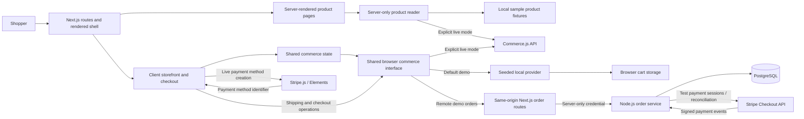

# Joy's Store

A Next.js storefront with a seeded demo you can purchase from without merchant credentials. The same catalog, cart, and shipping flow also supports the live Commerce.js and Stripe integration.

**[Open the live demo](https://joys-store.vercel.app)** — browse products, use the sample address, and complete a simulated purchase. No login or payment details are needed.

The portfolio direction is a polished, single-store commerce demo that shows the complete journey from a shopper placing an order to a merchant managing it. The goal is to demonstrate senior full-stack engineering through clear product decisions, reliable transactions, maintainable boundaries, and evidence from tests.

**Current status:** the Next.js storefront is deployed on Vercel. Remote demo mode supports persistent orders through a separate Node.js service and PostgreSQL, with reloadable private receipts and recovery after a lost response. GitHub CI and deployed purchase checks gate releases. Payments remain explicitly simulated; merchant tools remain planned.

The [Vercel release guide](docs/deployment.md) documents deployment checks, project configuration, release verification, and rollback recovery.

## What works today

- Next.js App Router routes for the catalog (`/`), products (`/products/[slug]`), cart (`/cart`), and checkout (`/checkout`), including direct navigation and reloads.
- Directly linked product pages with server-rendered descriptions, sample specifications and care guidance, individual page metadata, and loading, missing-product, and service-recovery states.
- Responsive product cards and cart quantity, removal, and clearing actions.
- A workspace-inspired storefront, shared visual theme, visible add actions, and confirmed cart feedback with a direct View cart action.
- Search names, descriptions, and sample specifications; sort by featured order, price, or name. Share `q`/`sort` URLs, restore results with browser history, and recover from empty results.
- Keyboard navigation, a skip link, and verified catalog layouts at phone, tablet, and desktop widths.
- Six seeded products with local illustrations, a cart that survives reloads, sample address entry, and simulated order confirmations.
- A controlled payment failure that preserves the cart and lets the shopper retry.
- When remote order storage is enabled: server-calculated quotes, durable orders, private `/orders/[id]` receipts, and duplicate-safe recovery after a timeout or reload.
- Shipping country, region, and delivery-method selection, including countries without regions.
- Order review based on the selected provider's shipping and tax calculations.
- Confirmation only after a successful capture returns an order; references come from the provider.
- Visible service errors and retries, address restoration when going back, and protection against repeated in-flight payment submissions.
- Checkout regression tests and production-browser smoke tests, with automated lint, test, and build checks.

## Foundation and architecture

| Area | Choice |
| --- | --- |
| Framework | Next.js 16.4.3 App Router with React 19.3.1 |
| Runtime | Node.js 24.22.2, pinned in `.nvmrc` |
| Package manager | npm 11.19.1, one committed `package-lock.json`, exact dependency versions |
| UI | Material UI 9.5.0 with Emotion and the Next.js App Router cache provider |
| Forms and payments | React Hook Form 7 and Stripe Elements |
| Verification | ESLint, Jest/React Testing Library, and Playwright |



`src/app` owns routing, metadata, the shared layout, and UI providers. `src/context/CommerceContext.jsx` preserves catalog and cart state across route navigation. Components under `src/components/CheckoutForm` collect the address, request totals, submit payment, and display the returned order.

`src/lib/storefront-config.js` validates catalog, payment, and order-storage capabilities separately. `src/lib/commerce.js` loads the selected adapter lazily in the browser. The default is a seeded catalog, simulated payment, and local orders; explicit provider settings select the supported combination. The old `NEXT_PUBLIC_COMMERCE_MODE` and `NEXT_PUBLIC_DEMO_ORDER_STORAGE` settings remain compatibility defaults. Merchant keys alone never enable live payments, and a live error never falls back to a simulated success. Importing or building a route does not initialize either provider. Product detail routes read independently through `src/lib/product-reader.js`; their content and metadata render on the server, with a small client purchase control. Demo pages are pre-rendered from local fixtures. Live detail reads use bounded, uncached requests to the merchant API and distinguish missing products from temporary failures. The catalog list, cart state, and checkout remain client-side. `/api/health` exposes public release identity and configured order-storage mode, not database readiness.

Remote simulated checkout is enabled by `NEXT_PUBLIC_ORDER_STORAGE=remote`. Canonical routes are `/api/checkout/quotes`, `/api/orders`, and `/api/orders/[id]`; the former `/api/demo/*` paths remain aliases for existing clients. Same-origin Next.js routes own an HttpOnly guest cookie and call [Ecommerce-Orders](https://github.com/joydas65/Ecommerce-Orders) using a server-only credential. PostgreSQL transactions persist a price snapshot, one order per quote, and the idempotency result together. The browser stores a recovery key before submitting and only clears the matching cart after validating a confirmed receipt. Remote failures never fall back to a local success. See [the persistent-order decision](docs/decisions/0006-persistent-demo-orders.md).

The demo uses integer cents, $5 standard or $12 express shipping, and a clearly labeled **8% sample tax** on products plus shipping. These are demonstration rules, not real tax or delivery quotes. Cart storage contains product IDs, quantities, and cart identity/version only. Remote recovery adds a quote ID, idempotency key, and cart identity/version. Names, email, street address and payment details are never sent to the demo order service. If browser storage is unavailable, browsing and the cart work in memory, but remote order submission stops before sending an order because safe recovery cannot be guaranteed.

The SDK’s Axios dependency is pinned to the patched 0.34.0 release through a scoped override. Contract tests cover the request and response shapes used by this app.

In the legacy integration, the browser passes a Stripe payment-method identifier to Commerce.js for order capture. The separate hosted Stripe adapter uses Ecommerce-Orders directly with the seeded catalog and remote storage. It is test-only: Session creation returns a pending order, and only verified server-side Stripe results produce a paid receipt. See [the provider separation decision](docs/decisions/0007-storefront-capabilities.md) for the supported combinations and rollout boundary. Decision records explain the [framework foundation](docs/decisions/0001-next-foundation.md), [demo provider boundary](docs/decisions/0002-seeded-demo.md), [catalog-to-cart experience](docs/decisions/0003-catalog-to-cart-experience.md), [product page boundaries](docs/decisions/0004-product-detail-pages.md), and [URL-driven catalog discovery](docs/decisions/0005-catalog-discovery.md), including screenshots.

## Run locally

Use Node.js **24.22.2** and npm **11.19.1**. If you use nvm, `nvm install` and `nvm use` read the pinned version from `.nvmrc`.

```sh
npm ci
npm run dev
```

Open [localhost:3000](http://localhost:3000). **No environment file, merchant account, or payment details are needed for the demo.**

### Try the demo

1. Open the [Desk Mat product page](https://joys-store.vercel.app/products/desk-mat), review the sample details, add it, and open the cart. Adjust quantities or reload to see the cart persist.
2. Choose **Checkout**, then **Use sample address**. Select a shipping option and continue.
3. Review the shipping and sample tax, then choose **Place demo order**. One Desk Mat with standard shipping totals **$42.12**.
4. Optionally select **Simulate a payment failure** before submitting. The first attempt shows an error and preserves the cart; the next attempt completes normally.
5. The confirmation has a `DEMO-` reference. No payment is collected and nothing is shipped. Return to the catalog to repeat; **Empty Cart** clears a saved cart.

### Share a collection view

Try [desk products sorted by price](https://joys-store.vercel.app/?q=desk&sort=price-asc#products). Search is applied with **Search** or Enter; sorting applies immediately. **Clear search** keeps the sort, while **Reset filters** restores the featured collection. Reloading, copying the URL, and browser Back/Forward restore the applied view.

### Optional persistent demo orders

Start [Ecommerce-Orders](https://github.com/joydas65/Ecommerce-Orders) with its local PostgreSQL setup, then add these values to the storefront's ignored `.env.local`:

```dotenv
NEXT_PUBLIC_CATALOG_PROVIDER=seeded
NEXT_PUBLIC_PAYMENT_PROVIDER=simulated
NEXT_PUBLIC_ORDER_STORAGE=remote
ORDERS_API_URL=http://127.0.0.1:4100
ORDERS_ALLOW_LOCAL_API=true
ORDERS_API_SECRET=local-orders-test-secret-at-least-32-characters
```

Use the same **local-only** fixture secret in the backend. Restart or rebuild the storefront after changing a public mode variable. Production requires a separate random secret and an HTTPS backend origin; loopback URLs are rejected on Vercel. Never prefix the service secret with `NEXT_PUBLIC_`.

Complete a purchase and choose **View saved receipt**. Reloading retains the order. Another browser cannot access it, and clearing cookies removes access. If the commit response is lost, **Recover pending order** retries the same submission rather than creating another one.

Remote checkout requires browser storage and the Web Locks API, available in current major browsers on HTTPS (or localhost for development). This coordinates submissions across tabs; unavailable coordination stops submission rather than risking an unrecoverable order.

### Optional direct Stripe test checkout

Configure the order service with a Stripe sandbox, its webhook signing secret, `STRIPE_PAYMENTS_ENABLED=true`, and a fixed `STOREFRONT_ORIGIN`. Follow the [backend setup](https://github.com/joydas65/Ecommerce-Orders). For local development, the backend also needs `ORDERS_ALLOW_LOCAL_STOREFRONT=true`; loopback return URLs are rejected on Vercel.

Use the same remote-order settings above, with:

```dotenv
NEXT_PUBLIC_CATALOG_PROVIDER=seeded
NEXT_PUBLIC_PAYMENT_PROVIDER=stripe
NEXT_PUBLIC_ORDER_STORAGE=remote
```

Checkout redirects to Stripe's hosted test page. Use only [Stripe test payment details](https://docs.stripe.com/testing). The return page shows pending, paid, canceled, or review-required status from the backend. **Returning from Stripe is not proof of payment.** A paid receipt follows a signed webhook or explicit server reconciliation that verifies the stored order, totals, currency, and test mode. The address form still uses sample details; nothing is shipped.

A lost response or reload reuses the saved quote and submission key. **Cancel checkout** expires the Stripe Session and checks its actual state; the browser Back button alone does not cancel a payment. Only a verified paid receipt clears the matching cart snapshot, preserving products added in another tab. Switching the payment setting back to `simulated` keeps the demo provider available without Stripe.

The public portfolio remains on its configured provider until a verified release activates a different one. No Stripe secret or webhook signing key belongs in this storefront or in its browser checks.

### Optional legacy Commerce.js / Stripe integration

Create an ignored `.env.local` (see `.env.example`) with your own public configuration:

```dotenv
NEXT_PUBLIC_CATALOG_PROVIDER=commercejs
NEXT_PUBLIC_PAYMENT_PROVIDER=stripe
NEXT_PUBLIC_ORDER_STORAGE=commercejs
NEXT_PUBLIC_COMMERCE_PUBLIC_KEY=your_commerce_public_key
NEXT_PUBLIC_STRIPE_PUBLISHABLE_KEY=your_stripe_publishable_key
```

Configure products, shipping options, and the Stripe gateway in the connected Commerce.js store, then restart development. Explicit live mode with missing merchant keys shows a recoverable unavailable state. Set catalog to `seeded`, payment to `simulated`, and order storage to `local` or `remote` to return to simulation. Demo and live carts use separate storage.

Next.js exposes `NEXT_PUBLIC_*` values to the browser and includes them in the build. Use only public or publishable keys, and rebuild after changing them for production. The old `REACT_APP_*` names are no longer used. Do not commit `.env.local` or place secret keys in browser configuration.

To run a production build locally:

```sh
npm run build
npm start
```

## Verify changes

| Command | Purpose |
| --- | --- |
| `npm run lint` | Check the codebase with no allowed lint warnings |
| `npm test` | Run Jest; append `-- --watch` for watch mode |
| `npm run test:ci` | Run the regression suite serially in CI mode |
| `npm run build` | Create the production Next.js build |
| `npm run check` | Run lint, regression tests, and the production build |
| `npm run test:e2e` | Run demo purchase tests, then live-mode foundation checks against separate production builds |
| `npm run test:e2e:demo` | Run only the seeded purchase and recovery browser tests |
| `npm run test:e2e:live` | Run only the live-mode checks with merchant keys deliberately absent |
| `npm run test:e2e:persistent` | Run the demo suite plus real persistent purchase, receipt and recovery checks; requires the local Node service and PostgreSQL |
| `npm run test:e2e:deployed` | Verify a public demo deployment using `E2E_BASE_URL` and optional `E2E_EXPECTED_COMMIT_SHA` |

Install Playwright's browser before the first browser-test run:

```sh
npx playwright install chromium
npm run test:e2e
```

Alternatively, use an already installed Google Chrome:

```sh
PLAYWRIGHT_CHANNEL=chrome npm run test:e2e
```

The Jest suite covers confirmed and failed captures, slow responses, duplicate submissions, cart preservation, shipping/tax calculations, lookup failures, stale responses, and address restoration. Product tests cover independent reads, merchant response validation, missing versus unavailable states, metadata, loading UI, and confirmed purchase feedback. Discovery tests cover query normalization, shared URL behavior, literal matching, deterministic numeric sorting, draft input, and empty-state recovery. Demo provider tests also cover persisted cart validation, stale checkout rejection, failure recovery, and repeated capture. Provider selection tests prevent implicit live mode or simulated fallbacks. Component tests mock provider interactions. SDK contract tests use the real Commerce.js and Axios packages with an injected in-memory HTTP adapter. No test charges a card or proves live provider integration correctness.

Playwright uses the real demo implementation to exercise shared searches, sorting, browser history, empty-state recovery, catalog-to-detail navigation, all six product deep links and reloads, server content with JavaScript disabled, product HTTP 404 recovery, mobile keyboard use, cart mutations and reloads, shipping totals, completed purchases, and controlled failure recovery. It rejects off-origin HTTP requests, uncaught errors, and hydration errors in demo mode. A separate production build verifies live-mode unavailable states, direct navigation/reloads, and the not-found page without merchant keys. Reports for each mode are kept separately.

[GitHub Actions](.github/workflows/ci.yml) runs lint, Jest, release-event validation, and production Playwright checks on pushes and pull requests. The [deployment workflow](.github/workflows/deployment-checks.yml) verifies Vercel's built demo before native Deployment Checks permit production promotion. Browser reports are retained as seven-day workflow artifacts. No merchant credentials are required by CI; see the [release guide](docs/deployment.md) for the external Vercel settings needed to enable the gate.

## Portfolio roadmap

Each milestone should leave a working, demonstrable application. Scope is one store and one merchant workflow.

| Milestone | Status and concrete result | Engineering discussion it supports |
| --- | --- | --- |
| 1a. Project foundation | Implemented: maintained runtime, Next.js routes, npm lockfile, modern UI dependencies, and automated checks | Reproducibility, framework boundaries, migration safety |
| 1b. Reproducible purchasing demo | Implemented: seeded products, explicit simulation mode, simulated purchases, and controlled failure recovery | Provider interfaces, deterministic testing, integration design |
| 1c. Vercel release foundation | Deployed: Git integration, previews, CI and deployed purchase gates, release identity, and recovery instructions | Deployment safety, least-privilege automation, verifiable releases |
| 2. Complete shopper experience | Catalog branding, responsive cards, keyboard access, confirmed add feedback, directly linked product detail pages, and search/sorting with shareable URLs implemented | Product judgment, accessibility, frontend architecture |
| 3. Full-stack order workflow | Persistent demo orders, authoritative price quotes, private receipts and guest authorization implemented; stock reservations and merchant administration remain planned | Data modeling, authorization, concurrency, transaction boundaries |
| 4. Reliable operation | Duplicate-safe demo submissions, response-loss recovery and real database/browser tests implemented; live provider reconciliation and broader monitoring remain planned | Failure handling, observability, security, operating a service |
| 5. Interview presentation | Hosted demo and decision records available; a polished walkthrough, screenshots, and broader measured results remain planned | Explaining tradeoffs and supporting claims with evidence |

### Next milestone: merchant order workflow

Build a bounded, authenticated merchant view on the persistent order model, with explicit permissions and an audit trail. Keep simulated purchases clear and avoid adding real payment handling before reconciliation and operational controls are designed.

## Current limits

- Search and sorting operate on the loaded collection. All six demo products are included; live merchant pagination and server-side full-catalog search remain future work.
- The default local demo stores only the cart in the browser. Remote mode persists synthetic orders; neither mode reserves stock, processes money, or synchronizes customer accounts across devices.
- Remote receipts are private to the guest cookie and expire after 30 days. They are not a substitute for authenticated customer order history.
- Live shipping and tax amounts come from Commerce.js; demo totals use the documented sample rules.
- Remote submissions are idempotent per guest and request key, and one quote can create only one order. Independent new quotes are independent purchases; this does not implement payment-provider reconciliation.
- A functioning merchant account is still needed for real catalog and checkout behavior. Provider sandbox checks and broader operational monitoring remain future work.
- Free-plan quotas can pause the hosted order service. Production commercial use requires a plan review; the demo does not claim an availability SLA.
- Planned features and metrics should be presented as completed only after implementation and verification.
