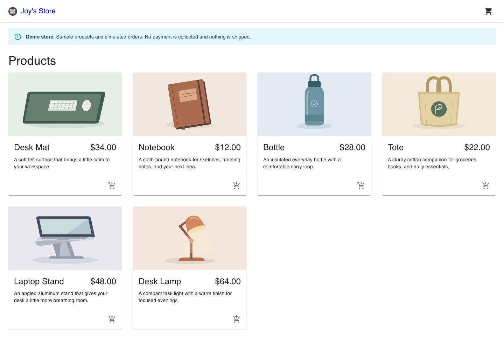
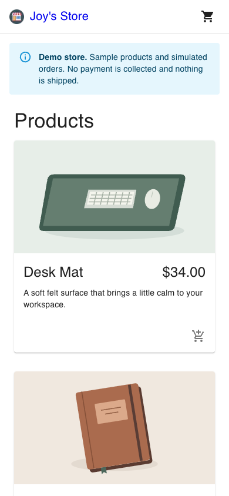
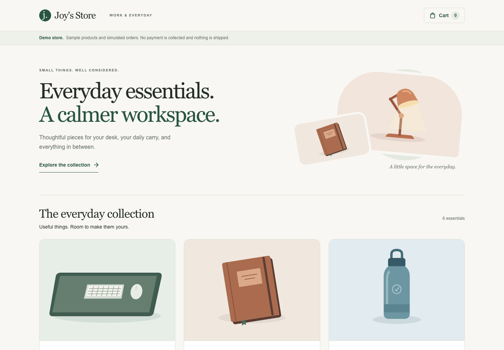
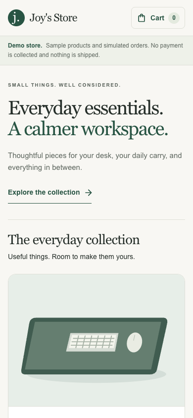

# 0003: Polish the catalog around a confirmed cart update

- Date: 2026-11-01
- Status: Accepted

## Context

The seeded catalog already supports complete simulated purchases, but its generic grid and icon-only add actions do not explain the store's identity or clearly acknowledge an addition. Six desk and everyday products make a coherent small collection. This increment should improve that shopping journey while preserving the tested checkout behavior.

## Decision

Use a restrained workspace-store identity: warm neutral surfaces, dark text, forest-green actions, serif display headings, and consistent product illustration framing. Define the palette, typography, focus treatment, and basic controls in the existing Material UI theme. Use local illustrations and system fonts so the demo retains its no-external-request guarantee and adds no dependencies.

Keep the catalog immediately browsable, with a short introduction, a three-column desktop grid, two columns on tablets, and a readable single column on narrow phones. Each semantic product article exposes its name, price, description, and a visible Add to cart button. A skip link and persistent header cart link support keyboard navigation. The demo disclosure remains explicit throughout the store.

A cart mutation now returns one of three outcomes:

| Outcome | Meaning | Catalog behavior |
| --- | --- | --- |
| `success` with `cart` | The provider returned a cart with a valid identity and item count | Update cart state and announce the confirmed product with a View cart action |
| `error` | The provider rejected or returned an invalid cart response | Preserve the current cart and show the existing retry message; show no success |
| `busy` | Another mutation is already in flight | Suppress the duplicate; show no success |

The catalog disables add actions while an update is pending and identifies the active product as Adding. Its local guard closes same-turn repeat clicks; the shared commerce guard also protects updates originating elsewhere. Starting a new attempt clears the previous confirmation. Successful feedback is a polite live region, does not take focus, and remains until dismissed or another add starts. Dismissal returns focus to the triggering product action.

This is an application UI contract, not server-side idempotency. A future backend must enforce its own transaction and retry guarantees.

## Scope and tradeoffs

- Reusing Material UI and the provider interface keeps the change focused and the checkout regressions useful.
- The shared theme intentionally carries the visual language into cart and checkout; their layouts and transaction behavior are not redesigned here.
- Product-detail routes, search, filters, and additional product data are subsequent increments. Six products do not yet justify a large discovery interface.
- The catalog remains client-rendered, as before. This release does not claim a server-rendered product catalog or a completed commerce backend.
- Existing local illustrations are demonstration assets. Real product photography, specifications, stock, reviews, and delivery promises need authentic merchant data.

## Verification and evidence

The regression suite covers slow adds, duplicate attempts, confirmed success, failure and retry, invalid provider responses, stale confirmation removal, and focus restoration. Production browser checks cover actual bounds and 44-pixel add targets at 360, 390, 768, and 1440 pixels, keyboard-only add-to-cart navigation, and the existing complete purchase and recovery journeys.

A separate axe-core 4.14.0 scan of 12 desktop/mobile catalog, confirmation-feedback, cart, shipping, payment, and order-confirmation views reported no WCAG 2/2.1 A/AA violations. This automated scan is a point-in-time check, not accessibility certification. Long unbroken names and a large formatted price were also visually checked at 360 pixels.

The same demo browser suite runs against the immutable Vercel deployment before production promotion. Screenshot attachments are retained with CI reports. `navigation-baseline.json` records navigation timing in each deployed run; it is a diagnostic rather than a performance score, and local-versus-hosted timing is not evidence of an improvement.

Before and after images below use matching viewport sizes and an empty cart. The before images are from the previous public release; the after images show this production build locally.

| 1440 × 1000 | 390 × 844 |
| --- | --- |
| Before:  | Before:  |
| After:  | After:  |

Research references: [Bellroy work accessories](https://bellroy.com/products/category/work-accessories), [MUJI desk accessories](https://www.muji.us/collections/desk-accessories), and [Baymard product-list usability](https://baymard.com/blog/product-listing-page-plp-ux). These informed the collection framing and information hierarchy; this project does not claim their measured outcomes.
