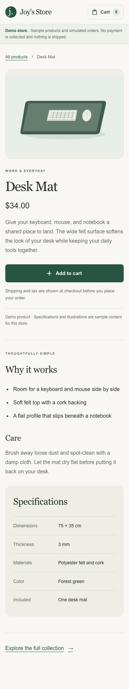

# 0004: Read product details independently of browser cart state

- Date: 2026-11-01
- Status: Accepted

## Context

The catalog supports a complete simulated purchase, but a shopper cannot inspect an item or share a product link. Product pages should work on a fresh visit and explain the product before the browser initializes its cart. Missing products and temporary service failures need different recovery paths.

## Decision

Use `/products/[slug]` with stable demo permalinks. Catalog cards have one heading link with a larger clickable surface; the add action remains a separate button. Breadcrumbs and recovery links return to the collection.

Product content is a server component. It renders the illustration, name, price, overview, features, specifications, and care guidance as HTML. A small client purchase component owns cart interaction. Catalog and detail pages share the same add hook and confirmation component, preserving explicit success, duplicate-click suppression, error recovery, and focus restoration.

The server-only product reader is separate from the browser commerce adapter:

| Mode | Read boundary | Failure behavior |
| --- | --- | --- |
| Demo | Local fixtures; six pages pre-rendered at build time | Unknown product returns not-found; no browser storage, SDK initialization, credentials, or network required |
| Explicit live | GET a product ID or permalink from the fixed merchant API origin | Only HTTP 404 means missing. Missing credentials, transport failure, invalid response, or other HTTP error means temporarily unavailable |

Live requests use a public merchant key, an eight-second timeout, no persistent fetch cache, and no redirects. The identifier is bounded and validated. The response is normalized to a small public product model, and merchant descriptions render as text. React `cache` deduplicates page and metadata reads within a render without retaining prices between requests. The installed SDK contract tests establish the ID/permalink request shapes; they do not establish live merchant connectivity.

The six demo fixtures add sample specifications without changing their product IDs or prices, so saved demo carts remain valid. These details are explicitly labeled as sample content. Live products show only data supplied by the merchant; demo specifications, reviews, stock claims, or delivery promises are never invented for them. Shipping and tax remain calculated and disclosed during checkout.

## Loading, missing products, and failures

- `loading.jsx` provides an accessible loading heading, status, and static skeleton. There is no artificial delay. Pre-rendered demo pages generally arrive immediately; the boundary also supports future/live reads.
- The demo layout checks the local product identity above the loading boundary. This lets direct unknown demo URLs return a real HTTP 404 before a loading response starts streaming.
- A parent product not-found boundary catches that layout guard; a route-level boundary also handles reader results. Both provide a product-specific message and a return link.
- Unavailable products show Retry, which refreshes the server read, and a return link. They do not offer an add action or masquerade as missing products. Their metadata requests no indexing.
- Next.js may return HTTP 200 for a live not-found result discovered after the loading shell has started streaming, while rendering the not-found UI and `noindex`. We do not claim every streamed live missing-product response is HTTP 404. See [Next.js not-found behavior](https://nextjs.org/docs/app/api-reference/file-conventions/not-found) and [loading boundaries](https://nextjs.org/docs/app/api-reference/file-conventions/loading).

## Scope and tradeoffs

This increment adds server rendering where it helps direct product access; it does not migrate the client catalog, cart, or checkout. Native semantic markup and a scoped stylesheet keep informational content outside the client purchase bundle while retaining the existing visual system. The root provider still initializes browser catalog/cart state after hydration.

Local SVGs and system fonts keep the demo self-contained. Product imagery reserves its aspect ratio. Missing merchant image URLs show a text fallback. The demo is not an indexed real merchant offering, so this change does not add fabricated reviews, availability, or commerce structured data.

Server cart authority, inventory checks, variant selection, product discovery, and application order persistence remain separate milestones.

## Verification and evidence

Unit tests cover independent fixture reads, immutable product data, invalid input, upstream errors/timeouts and malformed responses, merchant normalization, route/metadata outcomes, loading and recovery UI, and the shared confirmed-add contract.

Production browser tests exercise all six direct links and reloads, metadata, useful information, catalog-to-detail navigation, adding to a persisted cart, phone layout, keyboard actions, real demo HTTP 404/noindex recovery, and server-rendered information with JavaScript disabled. The live build is tested with merchant credentials deliberately absent. Existing complete simulated purchase and failure-recovery checks remain in the same suite. All demo product tests also run against the immutable Vercel deployment before production promotion.

The local release checks passed: 189 unit tests, 13 release-event tests, 20 demo and six live-mode production browser tests, lint, and both builds. An axe-core 4.14.0 scan of eight desktop/mobile product, confirmation, not-found, and catalog views reported no WCAG 2/2.1 A/AA violations. Visual review caught and corrected a link-color inheritance issue in the confirmation action; browser tests now measure its text contrast on desktop and mobile. Remaining automated review flags concern the decorative arrow and fixed-overlay background ambiguity. This is a point-in-time automated scan plus focused visual checks, not accessibility certification. A 320-pixel layout check with a long unbroken product name also passed.

| Desktop, 1440 × 1000 | Phone, 390 × 844 |
| --- | --- |
|  |  |
