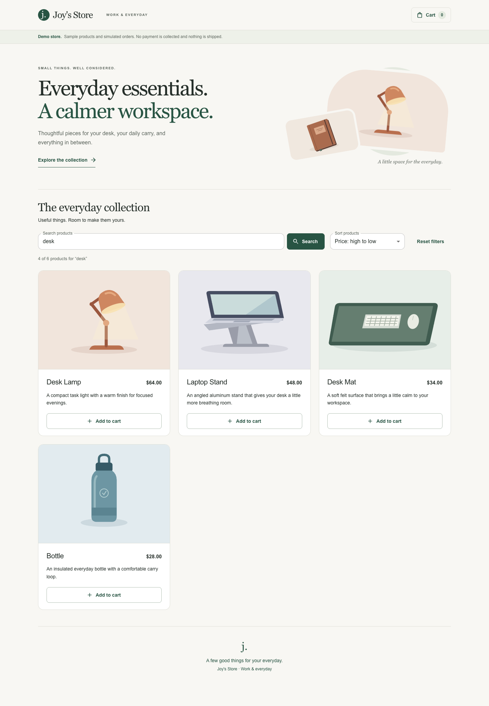
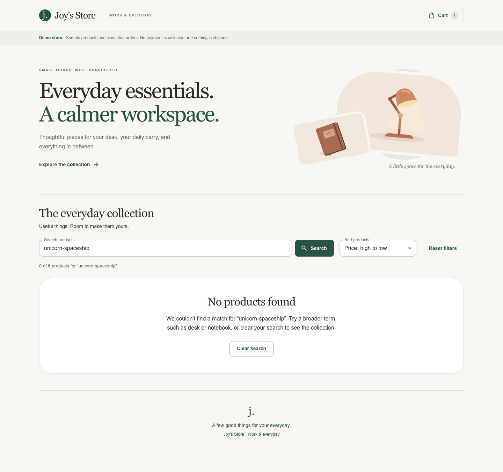
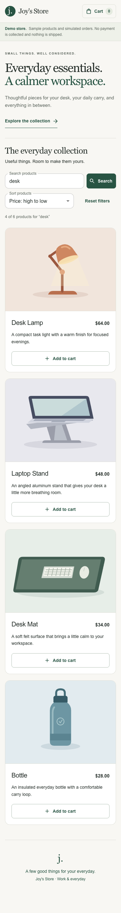
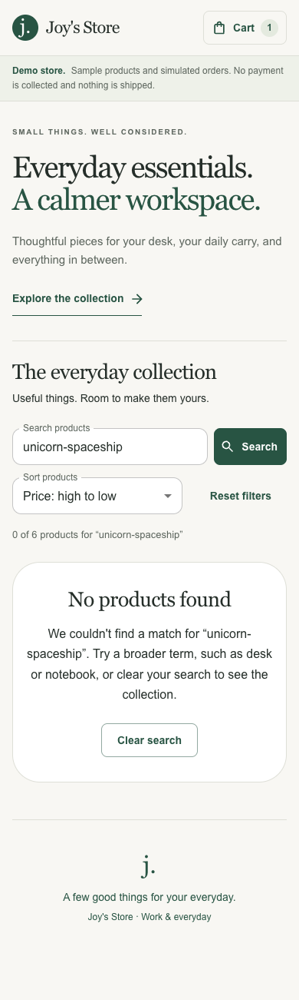

# 0005: Keep catalog discovery in the URL

- Date: 2026-11-01
- Status: Accepted

## Context

The catalog has directly addressable product pages and a complete simulated purchase flow. Shoppers should be able to narrow the collection, compare prices, and share the same result view. The current six-product demo does not need a search service or additional dependencies.

## Decision

Search and sort the loaded collection locally, using the URL as the applied state. Keep a separate draft for the search input: submitting with Search or Enter applies it, while changing the sort immediately reorders the currently applied results. Typing does not create history entries or silently change results. A sort change does not submit an unfinished search draft.

| Parameter | Values and normalization |
| --- | --- |
| `q` | Trimmed, repeated whitespace collapsed, limited to 120 characters; blank omitted |
| `sort` | `featured`, `price-asc`, `price-desc`, `name-asc`; unknown values become Featured; default omitted |

The first value wins when a shared URL contains duplicate managed parameters. User actions serialize one normalized value per parameter while preserving unrelated query parameters. Query text is encoded as URL data and rendered as text. Generated catalog URLs end with `#products`, so opening a copied view can take the shopper to the collection. Repeating an already canonical submission does not add another history entry.

Native `history.pushState` integrates with Next's `useSearchParams` without another server navigation. Browser Back/Forward and reloads restore applied controls and results. A Suspense boundary keeps the static production build valid. The search input stays mounted when URL state changes, preserving keyboard focus. Clear search removes the query and keeps sorting; Reset filters removes both. Explicit clear/reset actions return focus to the search input.

## Matching and ordering

Matching is case- and diacritic-insensitive. Every whitespace-separated query token must occur as a literal substring somewhere in the product's name, description, overview, features, specifications, or care text. This deliberately supports broad queries: `desk` includes the Bottle because its overview mentions desk use. It is not fuzzy, semantic, or ranked search.

Merchant descriptions are converted to plain text before indexing so HTML tags and hidden script/style content do not create false matches. The same pure text helper is used by server product reads. It is not an HTML sanitizer; its output is rendered as text.

Featured preserves the provider's order. Price sorting uses numeric `price.raw`, never formatted currency strings. Missing or invalid prices sort last in either direction. Equal prices use product name then ID for stable ordering; name sorting uses a fixed English natural collator. Filtering and sorting return a new array and never mutate the shared commerce state.

## Empty states and accessibility

The result count is a polite live region distinct from cart confirmation feedback. No matches shows the applied query, suggests a broader term, and provides Clear search. An entirely empty provider catalog retains its separate new-products message; provider failures retain their existing Retry flow.

Search has a visible label and a real form submission. Sort uses a labeled native select, preserving built-in keyboard behavior. Controls meet the existing 44-pixel target minimum, wrap at phone widths, and retain visible focus. Long query text wraps in summaries and empty-state messages.

Cart confirmation still returns focus to the original add action when dismissed. If a new search has removed that product from the result grid, dismissal returns focus to search instead of targeting a detached button.

## Scope and tradeoffs

This is complete search for the six local demo products. The existing live adapter loads one product-list response and does not handle merchant pagination, so this increment makes no full-store live search claim. Server-side pagination, filtering, search ranking, and indexed discovery should be designed together when a larger catalog warrants them.

The catalog remains client-rendered after its provider loads. Product detail pages retain independent server reads. Search does not change cart or checkout contracts, add a dependency, contact an external search service, or claim a measured conversion improvement.

## Verification and evidence

Unit tests cover parsing and serializing shared URLs, bounds and unsafe-looking query values, multiple terms, accented text, markup handling, missing prices, stable ordering, immutable input, draft-versus-applied state, focus, and reset recovery. Production browser tests cover fresh shared URLs and reloads, every sort, Back/Forward, returning from a product page, adding a filtered product to a persisted cart, escaped query text, invalid sort values, and phone keyboard/empty-state behavior. The same demo suite gates the immutable Vercel deployment before promotion.

Local release checks passed: 215 unit tests, 13 release-event tests, 31 demo and six live-mode browser tests, lint, and both production builds. An axe-core 4.14.0 scan of eight desktop/mobile default, filtered, confirmation, and empty-result views reported no WCAG 2/2.1 A/AA violations. Automated contrast checks marked outlined-control and fixed-overlay backgrounds for review; focused measurements found label contrast of 5.55:1 and input/select text contrast of 13.99:1. Screenshots were inspected for clipping and readability. This is a point-in-time check, not accessibility certification.

| Search and sort | No matches |
| --- | --- |
|  |  |
|  |  |

Framework references: [Next.js native history integration](https://nextjs.org/docs/app/getting-started/linking-and-navigating#native-history-api), [useSearchParams and static rendering](https://nextjs.org/docs/app/api-reference/functions/use-search-params), and [React guidance for adjusting state when inputs change](https://react.dev/learn/you-might-not-need-an-effect#adjusting-some-state-when-a-prop-changes).
