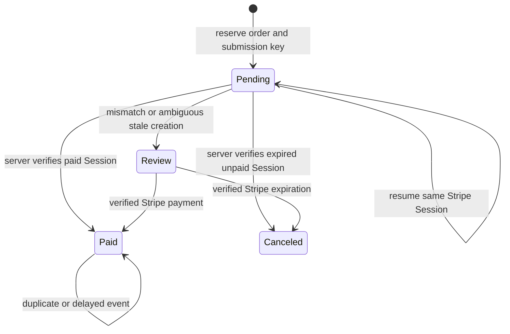
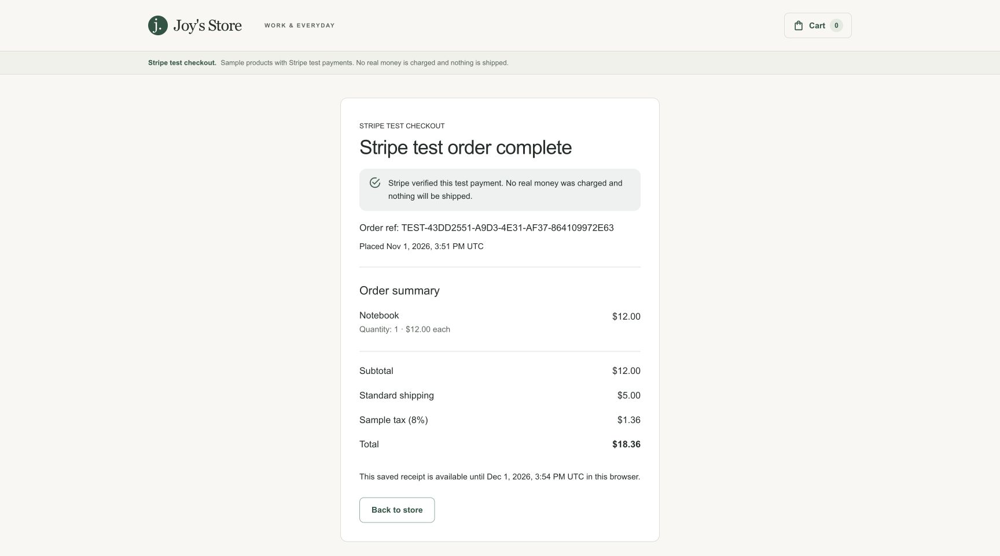

# 0007 — Separate catalog, payments, and order storage

Status: accepted. Provider separation and direct Stripe test checkout are implemented; deployment activation is a separate release step.

## Context

One `isDemoMode` flag selected products, cart behavior, payment UI, persistence, and presentation. The existing Stripe form collected a payment method for Commerce.js; it did not use the independent Node order service. Enabling it would not preserve the new durable receipts and recovery path.

## Decision

Resolve explicit capabilities once in `src/lib/storefront-config.js`. UI and route code depend on the capability they need: product pages use the catalog source, payment forms use the payment provider, and recovery uses order storage.

| Catalog provider | Payment provider | Order storage | Supported behavior |
| --- | --- | --- | --- |
| `seeded` | `simulated` | `local` | Credential-free local simulation |
| `seeded` | `simulated` | `remote` | Durable simulated orders and private receipts |
| `seeded` | `stripe` | `remote` | Direct hosted Stripe test checkout and verified paid receipts |
| `commercejs` | `stripe` | `commercejs` | Existing merchant integration |

The corresponding public variables are `NEXT_PUBLIC_CATALOG_PROVIDER`, `NEXT_PUBLIC_PAYMENT_PROVIDER`, and `NEXT_PUBLIC_ORDER_STORAGE`. Missing values use the existing legacy configuration as defaults. New explicit values take precedence. Unknown explicit values and unsupported combinations fail validation; credentials alone never select a provider. Existing deployment settings remain compatible.

The legacy Stripe form is isolated from the simulation form and initializes Stripe only when rendered. Confirmation requires an explicit provider-appropriate payment status; an ID alone cannot clear the cart. Remote submission, receipt validation, guest ownership, and recovery keep their existing guarantees.

Canonical browser-facing endpoints are `/api/checkout/quotes`, `/api/orders`, and `/api/orders/[id]`. Old `/api/demo/*` endpoints call the same handlers without redirecting or changing cookie identity. The remote simulated adapter remains explicitly named because it still implements simulated payment, not an unimplemented generic payment gateway.

## Direct Stripe rollout boundary

The hosted payment adapter uses Stripe test mode with the seeded catalog and remote orders. The backend reserves a durable pending order before creating a Checkout Session, persists immutable creation parameters and a stable Stripe idempotency key, and confirms only from a verified server-side Stripe result. Redirects, pending sessions, declines, and missing status must never appear as successful purchases. No Stripe error may fall back to simulation.

Signature-verified webhooks and return-page reconciliation share the same idempotent state transition. Exact amount, currency, ownership metadata, and test/live mode must match the stored quote. Pending financial state must survive retries and cleanup; stale ambiguous attempts must not create another payment after Stripe's idempotency retention window.

The current sample tax, sample shipping, and omitted fulfillment details do not support real commerce. Test mode is the intended first integration. The deployed browser gate selects the configured payment provider explicitly. Its Stripe path creates, verifies, and cancels a real sandbox Session without entering card details; the local browser contract suite uses synthetic responses and cannot call real payment services. Actual sandbox payment and webhook checks are separate from those fixtures. Production activation requires the backend migration, test-only settings and webhook, a reviewed backend revision in CI, and matching storefront/release-gate configuration.

## Verification

The quote expires after 15 minutes for starting a new payment. Once reserved, Stripe owns the Session lifetime. Unknown Session creation may be retried with the original parameters for at most 23 hours; afterward the order requires review, avoiding a fresh payment after Stripe may prune its idempotency record. Unresolved payment records are excluded from ordinary receipt cleanup.

Configuration tests cover defaults, explicit precedence, supported combinations, and invalid combinations. Payment and context regressions cover simulation without Stripe initialization, unavailable Stripe configuration, duplicate submission, and missing/unconfirmed payment status. Route tests verify canonical endpoints and compatibility aliases use the same ownership and request-validation rules. Browser tests exercise local and remote simulation, the legacy merchant unavailable states, and the hosted Stripe client contract. Backend integration tests exercise PostgreSQL reservations, retries, provider isolation, signature verification, event ordering, cancellation races, payment validation, and retention of unresolved attempts.

## References

- [Stripe Checkout fulfillment](https://docs.stripe.com/checkout/fulfillment)
- [Stripe webhook verification](https://docs.stripe.com/webhooks)
- [Stripe idempotent requests](https://docs.stripe.com/api/idempotent_requests)

## Sandbox verification evidence

Verified against an actual Stripe sandbox and local PostgreSQL, rather than only mocked responses: authoritative $18.36 total, stable Session on replay, owned pending receipt, cancellation plus a signed expiration event, declined test card followed by the same Session resuming, and a signed completion event producing one paid order. Reload preserved the private receipt; the cart cleared only after verified payment.

The SDK and API are pinned (`stripe` 23.1.0, API `2026-10-28.endive`). Actual integration testing caught the retired `payment_method_types` create parameter; the adapter uses `allowed_payment_method_types` and has regression coverage for that contract.

