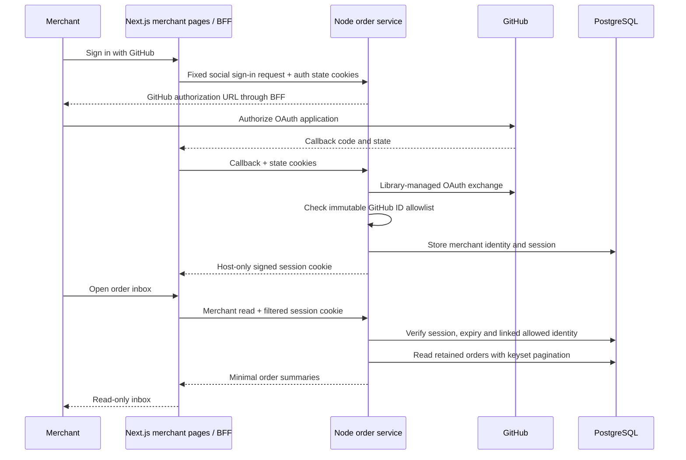

# 0008 — A private, read-only merchant order inbox

Status: accepted. Implemented and locally verified. Deployment and external GitHub OAuth verification follow the release procedure below.

## Context

The storefront can create persistent simulated and Stripe test orders, but the only viewer is the shopper's private receipt. A merchant needs an order inbox without treating a guest cookie, the storefront's service credential or knowledge of an order ID as administrative authority. The first increment should demonstrate the shopper-to-merchant flow while keeping order mutations out of scope.

## Decision

Keep the UI in the existing Next.js application and authentication beside the order data in the separate Node service. Use pinned Better Auth with GitHub OAuth and the existing PostgreSQL database. This adds no hosted authentication subscription and avoids adding a custom password or JWT implementation. The merchant allowlist uses immutable numeric GitHub account IDs, never display names, email addresses or submitted roles.

## Access boundary

Better Auth manages OAuth state, PKCE, session signing and provider-token encryption. Only GitHub social login is exposed. Password signup and automatic account linking are disabled. The allowlist is checked before a profile/account is created and checked again from persisted linked identity on every protected request. An authenticated ordinary user remains forbidden; there is no first-user administrator rule.

The browser receives an opaque signed session cookie, not an administrative JWT or shared API key. Sessions live in PostgreSQL and last eight hours without automatic extension. Cookie caching is disabled so revocation and expiry are observed on reads. Cookies are host-only, HttpOnly and SameSite=Lax, with Secure enabled for deployed HTTPS. Sign-out deletes the session; replaying the old cookie fails.

The storefront BFF forwards only the merchant cookie family. It never forwards a caller-supplied user ID, role, guest identity or checkout service bearer as authorization. It limits request/response sizes, validates fixed upstream origins, rejects unsafe redirects and preserves all approved state/session cookies. Both sign-in and sign-out require the exact configured storefront Origin. The callback always belongs to the canonical storefront domain.

Next.js protects the workspace layout for navigation and independently protects every merchant API through the backend. Hiding navigation is not the authorization boundary. Pages are dynamic/no-store and noindex; API responses are private/no-store. Misconfigured or disabled authentication fails closed only for the merchant feature, preserving public checkout.

## Read model and UI

`GET /v1/merchant/session` exposes only the authorized user ID and role. `GET /v1/merchant/orders` returns minimal summaries with status, provider, total, quantity and creation time. `GET /v1/merchant/orders/:id` returns a fixed receipt projection, excluding guest identifiers, idempotency keys, raw events, checkout URLs and provider payment IDs. Existing guest receipt routes retain ownership checks.

Filter values are `all`, `paid`, `pending`, `canceled`, `review` and `simulated`. Stripe test payments and simulated purchases have distinct labels. Filters and opaque cursors live in the URL; a filter change resets pagination. Loading, empty, forbidden, expired-session, unavailable and missing-order states have explicit recovery paths.

Pagination orders by `(created_at DESC, id DESC)`, with a unique tie-breaker and exact PostgreSQL timestamp precision. Versioned cursors are bounded, validated and tied to the selected filter. A cursor is a navigation position, not an access capability. The default page holds 20 orders, capped at 50. This is a live view: refresh reveals new arrivals, and concurrent newer inserts do not shift later pages as offsets would. It is not a transaction snapshot spanning multiple requests.

Resolved expired receipts stay hidden even before cleanup. Pending/review Stripe records remain visible until resolved, matching the existing payment-recovery policy. The inbox performs no payment reconciliation, fulfillment, refunds or overrides; those actions will need separate state transitions, concurrency controls and an audit trail.

## Data and operational tradeoffs

Authentication adds separate tables for merchant profile names/emails, linked provider identities, encrypted provider credentials, sessions, OAuth state and rate-limit counters. Guest order creation still stores no names, email, street address or card details. Authentication data never enters order DTOs or request logs.

The existing daily cleanup removes expired auth sessions and state, plus rate-limit counters older than a day. It retains stable users and linked account identities. Database-backed limits survive restarts, but the BFF may share a conservative rate-limit bucket; the system does not claim per-person or per-client-IP abuse protection. Broader monitoring and abuse controls remain future work.

Backend ownership keeps one session authority and avoids copying database credentials or OAuth secrets into Next.js. It adds a backend call for protected page/API reads and coordinated deployment when the contract changes. The read-only scope makes those boundaries reviewable before adding privileged actions.

## Verification and release

Implementation verification passed 496 storefront unit tests, 83 backend tests, 77 existing browser checks and seven merchant browser checks. Release-script checks, syntax/lint checks and the backend production dependency audit also passed. These are implementation evidence, not a claim that a particular deployment or external OAuth callback has passed.

Backend tests use real PostgreSQL and framework-signed sessions. They cover ordinary-user denial, tampered/expired/revoked cookies, allowlist changes, pre-signup OAuth admission, state/PKCE, sign-out, database failures and persistent rate limits. Query tests cover filter correctness, timestamp ties and microseconds, new inserts between pages, malformed cursors, retained pending orders and explicit field projection.

Storefront unit tests cover BFF cookie filtering, origins, redirects, bounded payloads, safe failures and UI states. `playwright.merchant.config.js` runs the browser journey against the local production build and real backend: shopper purchase to merchant inbox, detail reload, cursor navigation, filters/history, guest and ordinary-user denial, retry, mobile layout and session revocation.

The local suite invokes the backend's `scripts/test/seed-merchant-session.mjs`. It refuses Vercel and remote databases and requires explicit fixture opt-in. It creates private temporary session files, which the suite removes; authenticated traces and storage-state artifacts are excluded. Local fixtures do not replace external GitHub OAuth verification on the deployed canonical origin.

The deployed merchant gate receives an explicit `E2E_MERCHANT_ENABLED` boolean. It verifies anonymous navigation, uncached/noindex pages and denied API access without identity-provider requests, credentials or cookies. Real authorized OAuth is verified separately on the canonical origin.

Release the additive backend migrations and checked backend revision first, pin that revision in storefront CI, then release the storefront through its existing gates. Keep previews disabled unless separately isolated. Verify real GitHub sign-in, retained order reads and sign-out after promotion before claiming the feature is live.
