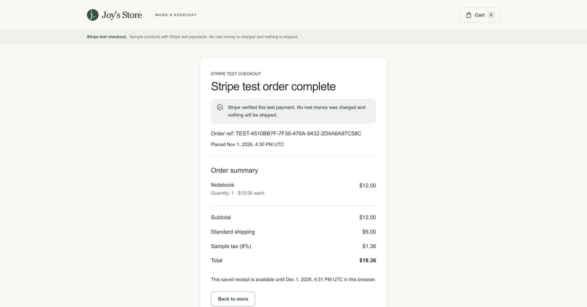

# Vercel release and recovery

Production is configured for a **seeded catalog, Stripe test checkout, and remote orders**. Local defaults and previews retain simulated checkout. `vercel.json` runs lint and Jest before a Next.js build, and validated public settings select catalog, payment, and storage independently. The release browser gate selects the configured provider and verifies the exact deployment before promotion. No real charges or shipments are supported. Storefront deployments are publicly accessible; no merchant credentials, Vercel deployment token, or protection-bypass secret are supplied to the browser workflow.

## Project and configuration

- GitHub repository: `joydas65/Ecommerce-Store`
- Vercel project: `joys-store`
- Project ID: `prj_lZSwq0GJzgZ89G01fTPPlYMCjdz2`
- Production branch: `main`
- Runtime: Node.js 24.x on Vercel; the local/CI patch version is pinned in `.nvmrc`.
- Repository linking metadata lives in ignored `.vercel/project.json`; local environment files are excluded from uploads by `.vercelignore`.

Public demo: **[joys-store.vercel.app](https://joys-store.vercel.app)**. Release identity is available at [`/api/health`](https://joys-store.vercel.app/api/health).

### First verified automatic release — 1 November 2026

Commit `e49c46d8675479ad1fba848cc1515f2e3c8a5f8b` was built from Git and automatically promoted after both native gates succeeded:

- [Local verification](https://github.com/joydas65/Ecommerce-Store/actions/runs/41282129962): lint, 92 Jest tests, 13 release-event tests, and 10 production-browser tests across demo and live-mode unavailable states.
- [Deployed verification](https://github.com/joydas65/Ecommerce-Store/actions/runs/41282241521): five browser tests against the immutable deployment, including exact commit identity, purchase success, controlled failure recovery, and cart synchronization.
- Vercel was observed in `READY / STAGED` with no production alias while the browser gate ran, then `READY / PROMOTED` with `joys-store.vercel.app` assigned. The public health endpoint returned the same commit and `mode: demo`.
- A superseded staged release passed its purchase tests but was rejected by the final branch-head check, confirming that an older commit cannot be approved by this workflow after `main` advances.

The release's runtime error query returned no records during verification. This is a point-in-time check; alerting, log drains, and service-level objectives are not configured. The rollback procedure below is documented; a rollback drill has not yet been performed.

These GitHub repository **variables** are configured. They are identifiers rather than credentials:

| Variable | Value |
| --- | --- |
| `VERCEL_PROJECT_ID` | `prj_lZSwq0GJzgZ89G01fTPPlYMCjdz2` |
| `VERCEL_PROJECT_NAME` | `joys-store` |
| `DEMO_ORDER_STORAGE` | `remote` for production; previews use `local` |
| `PAYMENT_PROVIDER` | `stripe` for production; previews use simulation |
| `MERCHANT_AUTH_ENABLED` | `true` for the merchant production release; previews use `false` |
| `CUSTOMER_AUTH_ENABLED` | `false` until Google OAuth setup and release approval; must match the deployed customer feature flag |

The Vercel project is connected to this GitHub repository with repository dispatch events enabled and production domain auto-assignment on. Native Deployment Checks require both of these GitHub checks for **production**:

| External check name | Purpose |
| --- | --- |
| `verify` | Lint, Jest, release-event validation, and local production-browser tests |
| `Vercel - Ecommerce-Store: production browser checks` | Purchase/recovery tests and revision identity on the deployed build |

Both checks block `deployment-alias`. The deployed-browser check requires `deployment-url`; the local CI check requires `build-ready`. Each times out after 25 minutes. These external settings are required: a workflow file alone does not enable release gating. Keep their names synchronized with the workflows when renaming jobs.

Vercel supplies `NODE_ENV=production` during builds. The build command sets `NODE_ENV=test` only for Jest so React's test helpers remain available, then builds Next.js in production mode. Local environment files are never uploaded.

## Normal release

1. Push a feature branch and open a pull request. GitHub runs local verification and Vercel creates a preview.
2. Vercel emits `vercel.deployment.ready` after building. The deployment workflow validates the Vercel app sender, configured project, HTTPS deployment origin, and a current branch commit in this repository. Fork references and stale deployments are rejected before tests run.
3. A job with read-only repository permissions runs the trusted default-branch browser harness against that deployment. `/api/health` must report the exact deployed SHA and `Cache-Control: no-store`. The Stripe gate additionally requires `providers: { catalog: "seeded", payment: "stripe", orders: "remote" }`. The legacy `mode` field is `live` for Stripe, including sandbox payments; provider configuration and receipt `paymentMode: test` identify the test flow. Health reports release identity, not dependency/database readiness.
4. A separate job reports the browser result to the **deployed commit**, not the dispatch workflow's default-branch SHA. Preview and production use different status names.
5. After a change reaches `main`, Vercel assigns production domains only when the required local and deployed checks pass. A failed check leaves the previous release serving traffic.

The GitHub workflow uses `repository_dispatch` rather than `deployment_status: success`, since a success notification may arrive only after promotion. It must exist on `main` before Vercel can trigger it. Browser reports and failure artifacts are retained for seven days. Production Stripe checks create an unpaid sandbox session, test receipt reload and guest isolation, then verify cancellation with the cart preserved. They never enter card details. Local persistent-order tests cover response-loss recovery with real PostgreSQL; previews use local simulation.

## Persistent order service

The backend lives in [Ecommerce-Orders](https://github.com/joydas65/Ecommerce-Orders), deployed separately as `joys-orders`. Its runtime and Neon Free database use US East, near the storefront runtime. Keep the Vercel account on Hobby and the database on Free; quotas can restrict service without upgrading the plan.

Set these **production-only** storefront variables once the backend's migrations and smoke checks pass:

| Variable | Purpose |
| --- | --- |
| `NEXT_PUBLIC_CATALOG_PROVIDER=seeded` | Select the sample catalog independently of payment |
| `NEXT_PUBLIC_PAYMENT_PROVIDER=stripe` | Select hosted Stripe test checkout; use `simulated` to retain simulation |
| `NEXT_PUBLIC_ORDER_STORAGE=remote` | Use the remote order service |
| `ORDERS_API_URL` | The backend's HTTPS `.vercel.app` production origin |
| `ORDERS_API_SECRET` | Random server-only credential shared with the backend; never expose it to the browser |

The previous `NEXT_PUBLIC_DEMO_ORDER_STORAGE=remote` remains a compatibility default. Keep GitHub variables `DEMO_ORDER_STORAGE=remote` and `PAYMENT_PROVIDER=stripe` aligned with the production build so its gate selects the correct suite. Preview environments omit the API credential and use local simulation. Neither production database credentials nor the service credential belong in storefront GitHub browser checks.

Activate persistent checkout with a new commit after saving these production settings. Wait for that commit's `verify` and `Vercel - Ecommerce-Store: production browser checks` results, then confirm the public `/api/health` reports the new commit and `orderStorage: remote`. Keep preview storage explicitly `local`. Rebuilding an already-approved commit can reuse earlier GitHub statuses, so a fresh commit is the activation path.

The initial backend production release is commit `f3bb23b5dcbdf5dc2d3bd4ac7711efa3e5c2f2f4` at `https://joys-orders.vercel.app`. Its verification and migration gates passed before promotion. The public API passed authentication, authoritative shipping totals, persistence, replay, receipt reload, guest isolation and price-tampering checks. A receipt created in staging also remained readable and replayable after the Git-based production deployment, verifying that its state lives in PostgreSQL rather than function memory.

Local CI checks out an immutable backend revision and uses a disposable PostgreSQL service. The backend owns versioned migrations, production migration automation, expired-record cleanup and its own release gate. Deploy a backward-compatible backend first, then the storefront. Changing its API contract requires updating the pinned integration revision and both test suites.

To rotate the service credential, coordinate the backend and storefront server-only values and redeploy both. A mismatched secret fails closed with a recoverable unavailable response; it cannot produce a false order confirmation. Do not reuse the documented local test fixture in cloud environments.

## Activate direct Stripe test checkout

Keep this separate from enabling real payments. The backend rejects live secret keys, and the storefront labels the hosted flow as test-only. Simulation remains available by selecting `simulated` instead of `stripe`.

On November 1, 2026, backend commit `20561b58cc07ab55e0fe153759fd0c2a8d418127` passed [verification and the additive migration gate](https://github.com/joydas65/Ecommerce-Orders/actions/runs/41326193927) before deployment. Storefront commit `2f0858d88f112eddd3a06a90ed70c3f016e90577` then passed [CI](https://github.com/joydas65/Ecommerce-Store/actions/runs/41326310303) and [deployed browser checks](https://github.com/joydas65/Ecommerce-Store/actions/runs/41326465401) before reaching the public alias. Health reported the exact revision and `seeded/stripe/remote` providers.

A public sandbox-card purchase independently verified the complete flow: Notebook $12.00, shipping $5.00, sample tax $1.36, total $18.36. Stripe reported `complete`, `paid`, and `livemode: false`; its signed webhook returned HTTP 200. The private receipt showed confirmation, cleared the matching cart, and remained confirmed after a full reload. An unsigned webhook returned HTTP 400. Runtime error scans for both released deployments were clean. These checks verify test payments only.



1. Release the reviewed backend revision and its additive `002_stripe_payments.sql` migration first. Existing simulated orders and legacy recovery keys remain compatible. Update the storefront CI backend pin to that revision.
2. In the backend production environment, set `STRIPE_PAYMENTS_ENABLED=true`, a sandbox `STRIPE_SECRET_KEY`, `STRIPE_WEBHOOK_SECRET`, and `STOREFRONT_ORIGIN=https://joys-store.vercel.app`. Keep secrets server-only. Register the sandbox webhook at `https://joys-orders.vercel.app/v1/webhooks/stripe` for Checkout completion, async success/failure, and expiration. Keep `NODEJS_HELPERS=0` so signature validation receives unmodified bytes.
3. Set storefront production catalog to `seeded`, payment provider to `stripe`, and order storage to `remote`. Set the GitHub repository variable `PAYMENT_PROVIDER=stripe` together with `DEMO_ORDER_STORAGE=remote`. Preview settings continue to use local simulation without backend credentials.
4. Release a new storefront commit. Its required deployed gate verifies the exact revision, test-mode capability settings, pending receipt ownership, and server-confirmed cancellation without entering card information. It cannot create a paid transaction. Inspect the matching public health revision only after required checks pass.
5. Verify a real sandbox-card flow separately. The local verification covered a declined card, a pending receipt with the cart preserved, resuming the same Session, a paid signed webhook, and a paid receipt that survives reload. Browser contract fixtures in CI do not replace this provider integration check.

To keep Stripe disabled, leave `PAYMENT_PROVIDER` unset or `simulated` in GitHub and select `simulated` in the storefront. A production setting change needs a new reviewed release; avoid reusing successful statuses for an older SHA.

## Activate the private merchant inbox

The merchant inbox and audited payment recheck are implemented. GitHub OAuth application registration and server-only configuration are prerequisites; those settings alone do not establish a successful release or sign-in. Use the checks below to establish deployment and external OAuth correctness for each activation.

The backend owns Better Auth, GitHub OAuth and PostgreSQL sessions. The storefront owns `/admin/sign-in`, `/admin/orders`, `/admin/orders/[id]` and the same-origin BFF. Public guest checkout stays available independently.

| Scope | Configuration |
| --- | --- |
| Storefront production | `MERCHANT_AUTH_ENABLED=true`, `MERCHANT_AUTH_ORIGIN=https://joys-store.vercel.app`, existing verified `ORDERS_API_URL` |
| Backend production | `MERCHANT_AUTH_ENABLED=true`, matching `BETTER_AUTH_URL`, independent `BETTER_AUTH_SECRET`, GitHub OAuth client credentials, `MERCHANT_GITHUB_IDS` |
| GitHub OAuth App | Exact storefront callback `https://joys-store.vercel.app/api/auth/callback/github` |
| Local integration | Explicit loopback opt-ins on both services; disposable PostgreSQL and synthetic credentials only |
| Previews | Merchant auth disabled unless a separate isolated backend, database and OAuth configuration are supplied |

None of the merchant variables use `NEXT_PUBLIC_`. The storefront does not receive the session signing secret, OAuth client secret, database credential or merchant allowlist. Its existing checkout service credential is not a merchant credential. OAuth is bound to the canonical storefront origin; an immutable deployment URL is not a second production sign-in origin.

Release in this order:

1. Verify the backend's real-PostgreSQL query and authentication tests, syntax checks, release checks and dependency audit. Apply additive migrations `003_merchant_orders.sql` and `004_merchant_auth.sql` through its main-only checked migration job.
2. Release the backend and confirm anonymous merchant reads fail closed while guest checkout and Stripe webhooks remain healthy. Auth configuration is initialized only for merchant/auth operations; a failure cannot grant access or disable the guest flow.
3. Set the storefront GitHub repository variable `MERCHANT_AUTH_ENABLED=true` for this production activation. The deployed merchant gate requires an explicit boolean and uses `false` for previews. Pin storefront CI to the reviewed backend revision. Its local merchant suite uses real signed sessions and a disposable database, with no production cookie, OAuth secret or database credential.
4. Release the storefront through the existing lint, unit, browser and deployed gates. Verify the public health revision. Anonymous access to `/admin/orders` should lead to sign-in; anonymous merchant APIs should return 401 when configured.
5. On the canonical production origin, complete GitHub sign-in with an approved account, inspect a retained order, exercise filters and pagination, reload its detail, and sign out. Confirm the old session no longer authorizes reads. Verify ordinary authenticated and anonymous rejection through the automated tests. Fixture-based local checks do not prove the external OAuth callback works.

Only explicit immutable GitHub IDs grant access, checked before signup and again against the persisted linked account for every merchant request. There is no bootstrap rule that makes the first user an administrator. Session cookies are host-only, HttpOnly, SameSite=Lax and Secure in production; they expire after eight hours without automatic extension. Sign-out deletes the database session. Removing an ID from the backend allowlist and deploying revokes its merchant authorization even if its cookie has not expired. Rotating the session secret invalidates all signed sessions.

The BFF forwards only the `joys_merchant` cookie family and preserves every approved state/session `Set-Cookie` header. It rejects cross-origin sign-in/sign-out/payment rechecks, unknown auth routes, arbitrary providers and callback destinations, and unsafe redirects. Merchant APIs expose no guest identity, session token, provider credentials, checkout URL or internal payment ID. Keep authenticated traces, cookie fixtures and browser storage-state files out of CI artifacts.

Auth tables retain merchant profile/email, encrypted OAuth credentials, sessions, OAuth state and rate-limit counters. Guest orders continue to omit personal shipping data. Daily backend cleanup removes expired sessions/state and counters older than a day while retaining stable merchant identities. Database-backed rate limiting survives function restarts but is conservative behind the BFF and may share a bucket; this release does not claim per-person/IP abuse protection.

See [decision 0008](decisions/0008-merchant-order-inbox.md) and the [backend runbook](https://github.com/joydas65/Ecommerce-Orders/blob/main/docs/deployment.md#merchant-authentication-and-inbox) for the access boundary and recovery details. The only merchant write is the audited recheck of an existing Stripe test session. Fulfillment changes and refunds remain separate increments. See [decision 0009](decisions/0009-merchant-payment-recovery.md).

## Release audited payment recovery

Apply the additive merchant-payment-check migration through the backend's normal verified main-only job, then release the backward-compatible backend before the storefront. No new vendor, credentials or environment flags are required. Pin storefront CI to the released backend revision.

Run `npm run test:e2e:merchant` with disposable local PostgreSQL and the local session signing fixture. Playwright starts `scripts/test/merchant-recheck-service.mjs` itself on port 4101. The fixture refuses Vercel and non-loopback databases; its separate HTTP provider exercises the actual Stripe SDK timeout and signed webhook path. CI does not receive production merchant cookies or Stripe credentials.

After release, sign in on the canonical origin. On an unresolved Stripe test order with an existing session, recheck payment status, verify the audit actor/outcome and reload the page. For a still-unpaid session, the saved status must stay pending. Check a completed request replay and inspect scoped runtime errors. Do not interpret a recorded check as a successful payment: only the saved verified status establishes payment.

The browser retains its request UUID in session storage after an ambiguous result. Use **Recover previous check** rather than creating another request. A completed request can be replayed even if a concurrent webhook already resolved the order. Rate limits and in-flight checks expose a retry time. If a function terminates, lease recovery fences off the old worker; the same request can be recovered after the lease expires.

The audit endpoint exposes only a bounded recent history and indicates when more events exist. Audit data includes merchant identity snapshots and is private. Application append-only events do not provide database-owner tamper resistance. Code rollback leaves additive schema and recorded checks intact; verify schema compatibility before rolling back.

## Google accounts

Status: implemented and locally verified; Google Cloud project/client registration and real deployed sign-in are pending approval. Follow [ADR 0010](decisions/0010-google-accounts.md) for the identity and ownership boundaries.

1. Create a dedicated Google OAuth project/client for Joy's Store, with no billing account or paid services. Configure only basic OpenID identity, email and profile scopes. Register the exact callbacks `https://joys-store.vercel.app/api/customer-auth/callback/google` and `https://joys-store.vercel.app/api/auth/callback/google`. Do not reuse production callbacks in previews or register wildcard callbacks.
2. Deploy the compatible backend and additive migrations `006_customer_accounts.sql` and `007_single_merchant_google.sql` through its gates. Configure backend-only `GOOGLE_CLIENT_ID`, `GOOGLE_CLIENT_SECRET`, `CUSTOMER_AUTH_SECRET` (random and independent of merchant/service secrets), `CUSTOMER_AUTH_URL=https://joys-store.vercel.app`, `CUSTOMER_AUTH_ENABLED=true` and `MERCHANT_GOOGLE_ENABLED=true`. Existing GitHub OAuth and its allowlist remain configured.
3. Keep storefront order storage `remote`. Set production `CUSTOMER_AUTH_ENABLED=true`, `CUSTOMER_AUTH_ORIGIN=https://joys-store.vercel.app`, and `MERCHANT_GOOGLE_ENABLED=true`. The storefront receives no OAuth or session secrets. Set the GitHub repository variable `CUSTOMER_AUTH_ENABLED=true` to match the deployed browser gate. Previews keep both new enable flags false.
4. Pin the reviewed backend revision in CI and activate with a fresh storefront commit so the tested build includes the Account navigation. Wait for the existing CI and deployed-browser gates. A same-SHA rebuild needs explicit staged-deployment verification as described below.
5. Verify real Google shopper sign-in, a new sandbox purchase appearing in My orders, private receipt reload, and sign-out. Sign in to the merchant workspace with GitHub, choose **Connect Google**, complete consent, then sign out and sign in with the linked Google account. The internal merchant/audit identity must remain unchanged. An unlinked Google account cannot enter the merchant workspace.

The Google client must be configured for the intended audience. Testing mode may restrict which people can authenticate; complete Google's applicable publishing requirements before advertising public shopper sign-in. Google consent/account verification can require the account owner's interaction.

Customer receipts are read-only from My orders. Orders remain available for the existing 30-day retention period after resolution, with unresolved Stripe orders retained. Switching accounts while recovering an in-flight checkout does not transfer its ownership; return to the original account and reuse the saved submission key. Logging out revokes the selected auth session; it does not delete local cart or guest receipt cookies.

Local browser checks use guarded, disposable PostgreSQL identities and dummy Google credentials. No production identity or token enters CI. These tests cover OAuth initiation; real external consent/callback verification is a separate release step. Rollback can disable the feature flags while preserving customer identities and additive schema; never drop customer tables during a code rollback.

## Inspect a release

Use an authenticated Vercel CLI linked to the intended project:

```sh
vercel inspect <deployment-url>
vercel logs --deployment <deployment-url> --query 'level:error' --since 30m
```

To run the deployed suite locally, use the immutable URL and full commit shown by the authenticated deployment inspection:

```sh
E2E_BASE_URL=https://<deployment-host>.vercel.app \
E2E_EXPECTED_COMMIT_SHA=<full-commit-sha> \
E2E_MODE=stripe \
E2E_MERCHANT_ENABLED=true \
E2E_CUSTOMER_ENABLED=false \
E2E_ORDER_STORAGE=remote \
npm run test:e2e:deployed
```

The suite starts no local server. Set `E2E_MERCHANT_ENABLED=true` for a configured production inbox or `false` for a disabled environment; omitting it fails the gate. Set `E2E_CUSTOMER_ENABLED` explicitly as well. Customer checks verify account navigation, noindex/no-store and anonymous or spoofed-identity denial without contacting Google. Merchant deployed checks verify sign-in navigation, noindex/no-store behavior and denial of anonymous or spoofed-identity API reads. They never sign in, call GitHub or acquire auth cookies. Stripe mode checks the health revision and capabilities, product routes and assets, a real unpaid sandbox session, private receipt reload, and cancellation without clearing the cart. Use `E2E_MODE=demo` for a simulated deployment; that suite also covers completed purchases, controlled failures, keyboard access, and cross-tab cart synchronization. Reports are written to `playwright-report/deployed` and `test-results/deployed`. A paid sandbox checkout must be verified separately with test card `4242 4242 4242 4242`, a future expiry, and a three-digit CVC.

## Roll back and resume

1. Inspect the failing deployment and identify the previous known-good **production** deployment. Check the project and commit before changing its production alias.
2. Run `vercel rollback <previous-production-deployment-url>`. The Hobby plan supports rollback to the immediately preceding production deployment.
3. Verify the public domain's `/api/health` commit and run the deployed suite against that domain with the expected restored SHA.
4. Fix the problem in a new commit. Check its staged production build and browser results.
5. Run `vercel promote <verified-production-deployment-url>` to resume production domain auto-assignment. Rollback pauses auto-assignment until promotion restores it.

Do not use Force Promote to turn a failed check into a successful release. Promote a tested production deployment: promoting a preview can rebuild it with production configuration, changing the tested artifact.

## Troubleshooting and boundaries

- **No deployment workflow run:** confirm the workflow is on `main`, Git integration is connected, and repository dispatch events are enabled.
- **Validator fails:** check repository variables and deployment metadata. A superseded branch commit is deliberately rejected; test the latest deployment instead.
- **401/403 from a preview:** this project's workflow expects a public demo URL. Do not add a secret to arbitrary dispatch URLs. A future protected deployment requires authenticated Vercel metadata validation and a reviewed, protected test harness before introducing any authentication credential.
- **Checks pass but the domain remains on an older release:** inspect native Deployment Checks, exact check names, and whether a previous rollback disabled auto-assignment.
- **Repeated deployment of the same SHA:** GitHub statuses are commit-scoped and may reuse an earlier success. Use a new commit for normal releases. For an intentional same-SHA configuration rebuild, stage production without assigning domains, test that exact deployment URL, and promote that tested production build explicitly.
- **Test purchases only:** production uses Stripe sandbox payments and previews use simulation, both with seeded fixtures. Use sample customer details. A real commerce release needs its own operational readiness and environment review.
- **Merchant sign-in unavailable:** confirm both server-only enable flags, matching canonical origins, backend OAuth configuration, callback registration and completed auth migrations. Keep previews disabled instead of sharing production auth state. An unauthorized GitHub identity must never be added automatically.
- **Recovery scope:** rolling back either application does not revert database writes. Keep migrations backward-compatible, preserve idempotency records through their retention period, and inspect the backend recovery guide before a schema change.

References: [Vercel Git integration](https://vercel.com/docs/git/vercel-for-github), [Deployment Checks](https://vercel.com/docs/deployment-checks), [rollback](https://vercel.com/docs/cli/rollback), [promotion](https://vercel.com/docs/cli/promote).
